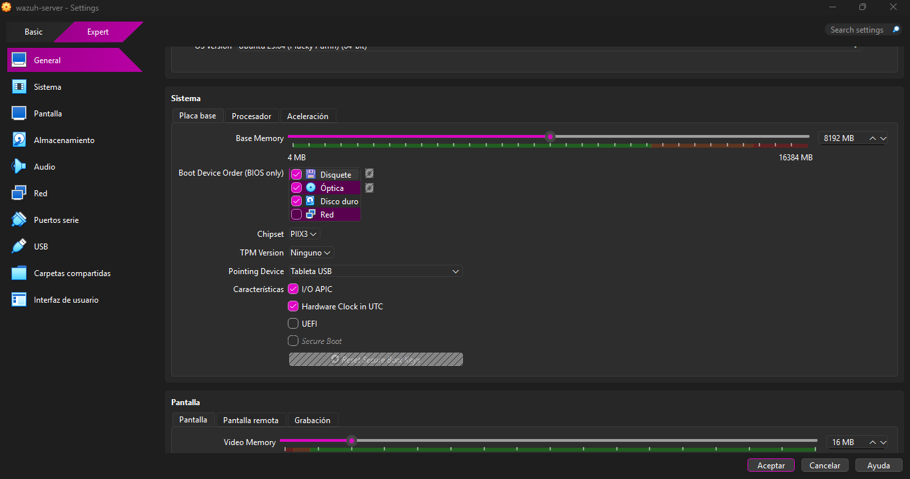
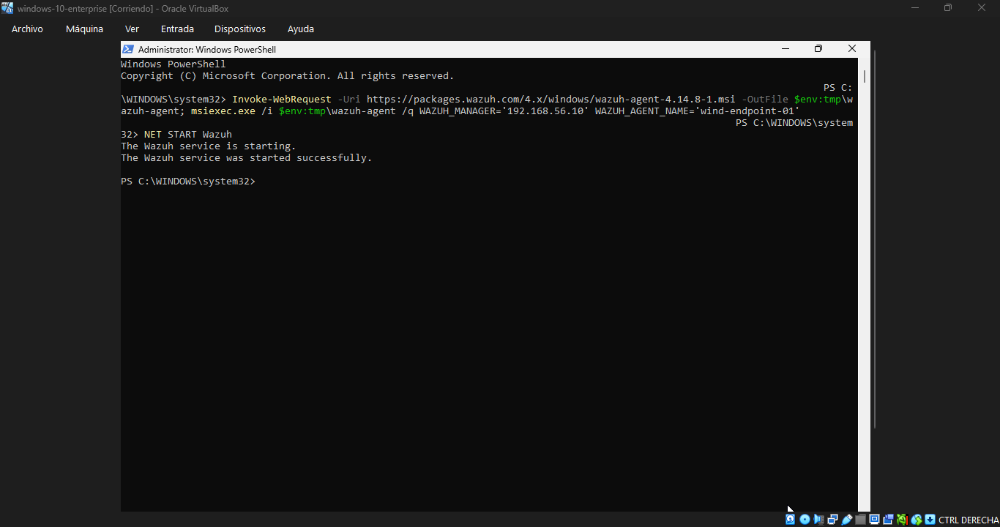
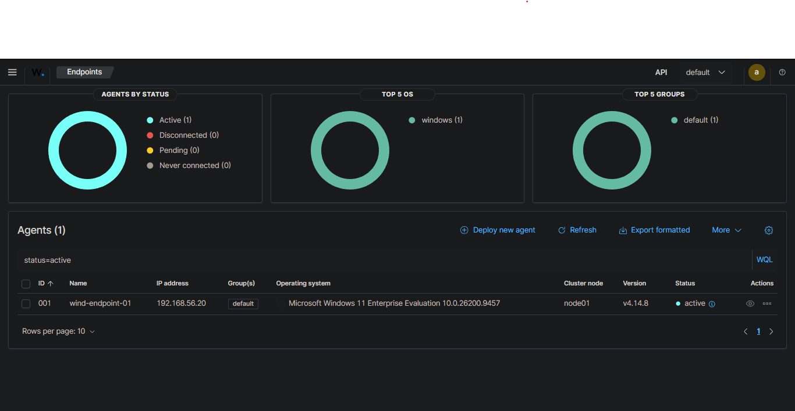

# 01 - Servidor Wazuh

## Objetivo
Desplegar un servidor Wazuh (manager, indexer y dashboard) en una VM Ubuntu Server, dentro de una red de laboratorio aislada.

## Especificaciones
| Parámetro | Valor |
|---|---|
| SO | Ubuntu Server 24.04 LTS |
| Wazuh | 4.14 |
| Recursos | 4 vCPU, 8 GB RAM, 50 GB de disco |
| Red | Adaptador 1 NAT + Adaptador 2 Host-only (192.168.56.10/24) |


*VM del servidor Wazuh: 4 vCPU, 8 GB de RAM y 50 GB de disco. El adaptador 1 es NAT (acceso a internet) y el adaptador 2 es Host-only (red aislada del laboratorio).*

## Procedimiento
1. Creación de la VM en VirtualBox con dos adaptadores de red (NAT + Host-only).
2. Instalación de Ubuntu Server con OpenSSH.
3. IP estática en el adaptador Host-only mediante netplan.
4. Instalación de Wazuh con el asistente oficial:

```bash
   curl -sO https://packages.wazuh.com/4.14/wazuh-install.sh && sudo bash ./wazuh-install.sh -a
```

5. Verificación de los servicios:

```bash
   sudo systemctl status wazuh-manager wazuh-indexer wazuh-dashboard --no-pager
```


*Los tres componentes de Wazuh (manager, indexer y dashboard) corriendo como servicios de systemd.*

6. Acceso al dashboard desde el navegador del host (`https://192.168.56.10`).


*Dashboard de Wazuh tras el primer inicio de sesión exitoso.*

## Notas
- Las contraseñas generadas por el instalador no se incluyen en el repositorio.
